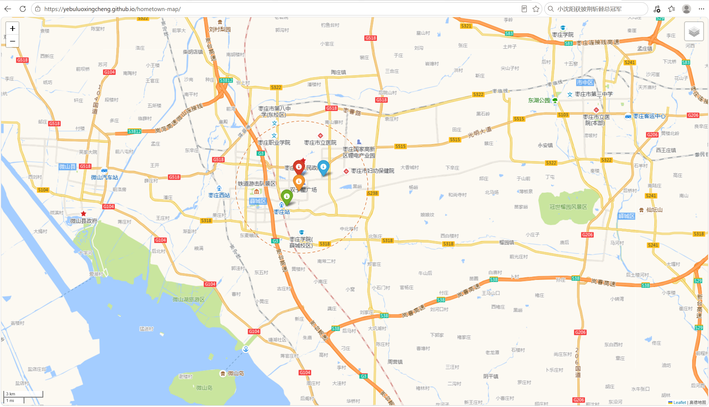

# 我的城市 · 第一张地图（枣庄新城）

> 90 天 P0 的第一步：把「我生活的地方」变成一张能解释的地图，并发布到网上。
> 山东科技大学 测绘与空间信息学院 · 地理信息科学 2026 级 · 2026 秋

**在线地址**：https://yebuluoxingcheng.github.io/hometown-map/

## 这张图回答什么问题

我常去的 4 个地方，离几何中心有多远？谁最远？

（P1 会升级成「到最近医院 / 公园的步行距离」，那是 11 月的事。）

## 本周交付

- [x] 一个能打开的网页链接（GitHub Pages）
- [ ] 这份 README，含结果表和截图
- [ ] 至少 3 条有意义的 commit

## 0. 装环境（约 30 分钟，只做一次）

| 软件 | 下载 | 安装时注意 |
| --- | --- | --- |
| Python 3.12 | https://www.python.org/downloads/windows/ | **第一页勾选 Add python.exe to PATH** |
| Git | https://git-scm.com/download/win | 一路默认；Default editor 那步选 Visual Studio Code |
| VS Code | https://code.visualstudio.com/ | 装完在扩展里搜 Python 装上 |

国内下载慢的话，Python 用华为云镜像：https://mirrors.huaweicloud.com/python/

装完关掉所有终端，重新打开 PowerShell，逐条执行：

```powershell
python --version
git --version
code --version
```

三条都出版本号才能往下走。

## 1. 填真实数据（约 30 分钟）

打开高德坐标拾取器：https://lbs.amap.com/tools/picker

1. 左上角搜地点（先搜「枣庄站」试一下）
2. 点地图上的点，右上角会出现「经度,纬度」
3. 复制，填进 `places.csv` 对应行的 `lon`、`lat` 两列
4. 把「高中」「常去的商场」改成你真实去的地方

**坐标系**：高德拾取器给的是 GCJ-02，高德底图也是 GCJ-02，所以直接叠能对齐。
以后用 GPS 或 OSM 的 WGS84 坐标直接叠，会偏 300–500 米——那是下一个坑，本周先不碰。

> 高德瓦片是公开接口，学习项目够用；长期公开或商用要换官方 Key。

## 2. 跑起来

```powershell
cd hometown-map
python -m venv .venv
.\.venv\Scripts\Activate.ps1
pip install -r requirements.txt -i https://pypi.tuna.tsinghua.edu.cn/simple
python check_env.py
python hometown_map.py
```

`Activate.ps1` 报「禁止运行脚本」时，改用：

```powershell
.\.venv\Scripts\python.exe -m pip install -r requirements.txt -i https://pypi.tuna.tsinghua.edu.cn/simple
.\.venv\Scripts\python.exe check_env.py
.\.venv\Scripts\python.exe hometown_map.py
```

生成 `docs/index.html`，双击就能看。底图加载不出来时先检查网络，再重跑一次。

## 3. 发布（本周的重点）

先在 GitHub 网页上新建空仓库 `hometown-map`（不要勾 README），然后：

```powershell
git init
git add .
git commit -m "feat: 第一张家乡地图"
git branch -M main
git remote add origin https://github.com/<你的用户名>/hometown-map.git
git push -u origin main
```

推送要密码时，用 Personal Access Token，不要用登录密码：
GitHub → Settings → Developer settings → Personal access tokens → Fine-grained tokens
→ 勾选该仓库的 Contents 读写权限 → 生成，复制当密码用。

开 Pages：仓库 → Settings → Pages → Source 选 `Deploy from a branch`
→ 分支 `main`、目录 `/docs` → Save。
等 1 分钟，访问 `https://<你的用户名>.github.io/hometown-map/`。

## 结果

几何中心取 4 个地点经纬度的算术平均，距离用 haversine 公式计算。

| 地点 | 类别 | 到中心距离 (km) |
| --- | --- | --- |
| 常去的商场 | 商业 | 0.4 |
| 家 | 家 | 0.9 |
| 枣庄站 | 交通 | 1.8 |
| 高中 | 学校 | 1.8 |

最远的是枣庄站和高中，约 1.8 km；4 个点都在 2 km 范围内。



## 目录

```
hometown-map/
├── places.csv         # 你的地点（要填经纬度）
├── hometown_map.py    # 读数据 → 算距离 → 出地图
├── check_env.py       # 环境体检
├── requirements.txt
├── metrics.csv        # 脚本生成的距离表
└── docs/
    └── index.html     # 脚本生成的地图网页（Pages 用）
```

## 验收（全做到才算这周完成）

- [ ] 链接能在手机上打开，底图不是空白
- [ ] README 里有结果表和截图
- [ ] `git log --oneline` 至少 3 条，提交信息能看懂
- [ ] 能向别人解释：为什么高德拾取器的坐标不用转换
