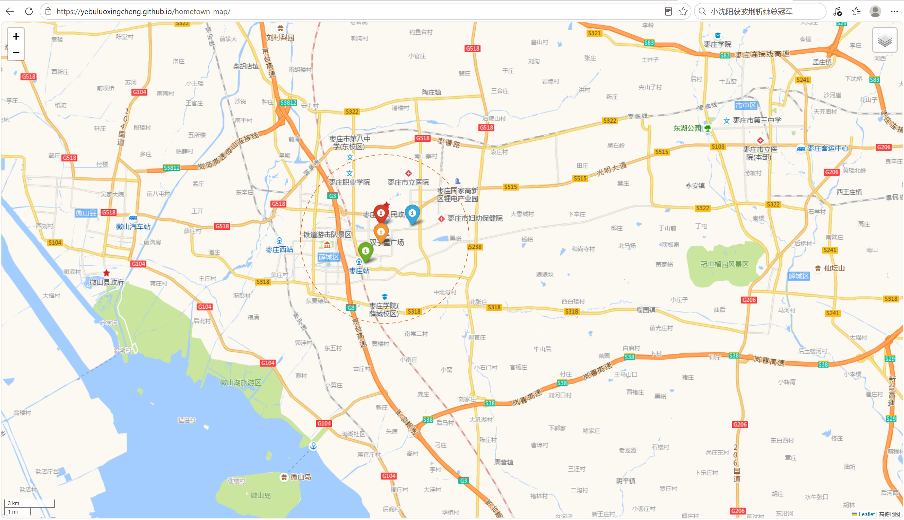

# 我用四个地点，做了张会回答问题的小地图

## 为什么做

起因很小：我想知道家到高中到底多远。

打开地图软件量一下也能知道，但我更想试试另一件事——把这几个地方整理成数据，再让 AI 读一遍，它能不能回答“我家附近有什么”这种问题。

还有个更实际的原因：我想知道自己能不能独立把一个东西从数据做到上线。课上讲的缓冲区、距离、坐标，落到一个能点开的网页上，中间还差多少。

## 做了什么

四个地点：家、高中、枣庄站、常去的商场。以这四个点的几何中心为圆心画一个 5 公里的圈，再算每个点到中心的直线距离。

结果和我预想的不太一样：四个点全在 2 公里以内。最远的是枣庄站和高中，都是 1.8 公里；最近的是商场，0.4 公里。1.8 公里这个数，比我以为的近。

技术上没什么新鲜的：pandas 读 CSV，haversine（球面两点距离公式）算距离，Folium 画地图，Streamlit 套一层页面，问答调 DeepSeek 的接口。地图导出成 HTML 推到 GitHub Pages，问答那部分放在 Streamlit Cloud。

- 动态版（能问答）：https://hometown-map-bnzcbcigyxm3mbahrfwyit.streamlit.app/
- 静态版（只有地图）：https://yebuluoxingcheng.github.io/hometown-map/

## 三个坑

**一、CDN 打不开。**

Folium 生成的 HTML 默认从 jsdelivr 拉 Leaflet 的脚本，国内经常一直转圈。地图一片空白，但代码不报错。换成 bootcdn 的镜像就好了。

**二、底图 403。**

Folium 默认把两个底图都打开，OSM 叠在高德上面。本地用 `file://` 打开时，OSM 拒绝这种请求，整屏都是它的 403 提示。删掉 OSM 图层、只留高德就好了。

顺带一个坑：高德是 GCJ-02，OSM 是 WGS84，混着用会偏三四百米。我一开始没注意，后来把坐标统一成高德坐标拾取器给的 GCJ-02，才对齐。

**三、CSV 变成 GBK。**

用 Excel 打开再另存，编码就从 UTF-8 变成 GBK。VS Code 按 UTF-8 打开，中文全变成 `�`；更糟的是我顺手按了保存，`�` 被写回磁盘，原来的中文就没了。最后从磁盘重写了一份，并给读取加了编码兼容。

这三个坑有个共同点：它们都不是算法问题。真正的麻烦是，东西在你的电脑上能跑，在别人那里打不开。

## 哪里不行

- **只有四个点。** 这是最实在的限制。缓冲圈和“附近有什么”这种问题，四个点撑不起来。
- **直线距离不是步行距离。** 1.8 公里直线，实际走可能要绕。
- **单轮问答。** 模型不记得上一句。问完“我家在哪”，再问“那附近呢”，它不知道“那”指什么。
- **实体对齐靠提示词。** 把用户说的名字对应到数据里的地点，这一步叫实体对齐。数据里没有“三中”，它可能硬套到“高中”上。这是幻觉的一个来源。
- **API 要花钱。** 应用一公开，任何人点一下都在花我的额度。上线之后才补的限额：每个会话 10 问，全站每天 200 问。计数放在进程内存里，重启会清零——这个限制我知道，但先这样。
- **数据有一处小事故。** 我想加“凤鸣湖”，搜出来的第一个结果是北京的同名公园，坐标不对。最后没放进去。

## 下一步

短期想把数据换掉：不用我自己挑的四个点，换成真实的小区、学校、公交站，至少几十个。

再往后是 P1：15 分钟生活圈。那个才是这个专业真正在做的题——不是画点，是算“从家出发，十五分钟能到哪”。

这篇先记到这。项目不大，但它是我第一个从 CSV 做到线上链接的东西。

代码：https://github.com/yebuluoxingcheng/hometown-map

2026 年 11 月
